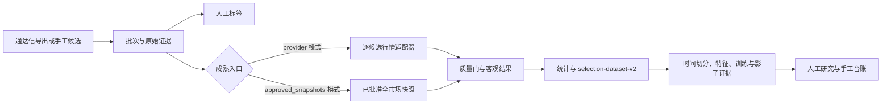

# StratGauge 系统规格说明

> 衡量优势，以证据交易。

本文是当前代码实现的技术基线，描述产品边界、模块职责、数据契约、缓存策略、选股成熟链路、机器学习链路和已实现 HTTP API。具体命令参数与每个输入框的使用方法见 [`docs/使用文档.md`](使用文档.md)。当本文与历史计划冲突时，以当前代码、测试和 `docs/current-state.md` 的事实为准。

## 1. 产品定义与边界

StratGauge 是面向单个用户的半自动 A 股研究和决策支持应用：通达信或用户产生候选，系统保存证据、连接日线行情、计算客观结果、统计历史样本，并以只读方式展示模型证据。

系统不连接券商，不自动下单，不自动修改策略或模型，不提供收益保证。用户始终负责确认、下单、成交确认和复盘。

当前实现重点是一个可复现的半手动闭环：



### 当前包含

- 沪深主板日线数据、Tushare 主源、BaoStock 备用/交叉校验、AKShare 兼容源和歪枣网临时恢复源；
- 内容寻址 raw JSON、标准化 Parquet、DuckDB 清单和质量报告；
- Tushare `stock_basic`、交易日历、时间点股票池和证券主数据快照；
- 通达信 CSV/TSV/分号分隔/TXT/EBK 导入、手工候选、人工标签、固定持有期客观结果和成熟任务账本；
- 全市场逐交易日行情、复权因子和只消费批准快照的快照重放成熟队列；
- 特征契约、历史时间点保护、离线常数基线、可选 LightGBM、走步验证、validation-only PAVA 校准、模型注册/比较/影子评分/漂移报告；
- 公式和批次管理、条件历史统计、只读推荐工作台、证券搜索和手工订单/成交/持仓/复盘 API 及 React 前端。

前端研究导航以“策略信号”为默认首页；独立“工作台”入口已移除。策略信号、观察池、持仓、交易记录、策略和分析继续共享 `/v1/workbench/*` 只读投影与股票详情抽屉；“推荐工作台”仍位于导入数据页中，是独立的只读推荐证据面板。

### 当前不包含

- 券商连接、自动交易、分钟线、Tick、新闻驱动信号；
- 通达信公式解析器或执行器；
- Web 请求内训练模型、自动晋升模型、自动选择 provider；
- 将未校准模型分数渲染成权威胜率；
- 用当前股票池回答没有历史快照的历史查询。

## 2. 模块与目录

```text
StratGauge/
├── backend/
│   ├── src/stratgauge/
│   │   ├── api/                 FastAPI 路由、请求模型和应用服务
│   │   ├── domain/              证券、行情、策略、选股、组合领域模型
│   │   ├── data_sources/        Tushare/BaoStock/AKShare/歪枣网适配器
│   │   ├── data_pipeline/       导入、同步、缓存、快照、质量门和存储
│   │   ├── features/            特征版本、时间点校验和特征快照
│   │   ├── backtest/             入场政策、结果、统计、数据集和任务
│   │   ├── strategies/           安全 AST、策略存储和生命周期
│   │   ├── application/ml/      显式训练与研究证据 application service
│   │   └── ml/                  训练契约、校准、注册、比较、影子和漂移
│   ├── scripts/                 显式 CLI；不注册后台定时器
│   └── tests/                   默认离线单元/契约/回归测试
├── frontend/src/                React/Vite/TypeScript 研究前端
├── docs/                        规格、使用说明、决策、状态和会话记录
└── data/                        默认本地运行数据，不应提交到 Git
```

后端是模块化单体。领域逻辑不直接依赖第三方 provider；provider 库只在 `data_sources/` 内导入。长流程通过本地任务账本和显式 CLI/Windows Task Scheduler 调度，不引入 Redis/Celery。主板行情同步任务由 `LocalJobStore` 持久化，FastAPI 不启动后台线程或定时器；API 只负责入队、查询、取消和显式执行一次。

## 3. 时间点、身份和不可变性

### 3.1 时间字段

- `event_time`：市场事件发生时间，日线默认按交易日 15:00（Asia/Shanghai）表达；
- `available_at`：系统认为该记录可供研究使用的时间；标准化时至少不早于抓取时间和日线事件时间；
- `ingested_at`：进入本地系统的时间；
- `as_of`：调用方要求的研究可见时间；
- `selection_date`：候选/信号归属日；
- `evaluated_at`：成熟结果允许看到后续行情的截止时间；
- `observed_at`/`known_at`：证券主数据的观察/知晓时间；
- `created_at`：快照、任务或模型证据的创建时间。

所有带时区的时间都由 Pydantic 领域模型验证；无时区输入失败。特征引擎同时要求行情交易日严格早于 `selection_date`，且每条行情 `available_at <= as_of`。

### 3.2 证券身份

领域层只接受 `SH`、`SZ`、`BJ` 三种交易所，并由 `canonical_symbol(local_code, exchange)` 生成 `CODE.EXCHANGE`。六位代码前缀不是交易所契约。名称是显示属性，不是主键；用户名称覆写只影响显示层。

### 3.3 内容身份

原始请求参数、记录、适配器版本和抓取时间进入内容寻址 payload；raw、规范化数据、manifest、质量报告和模型工件均保留 SHA-256。重复内容返回相同 snapshot/model ID；不同内容不覆盖旧证据。manifest 的状态可以从 `pending` 更新为 `approved`/`rejected`，但不会改变 raw 或 normalized 内容。

## 4. 数据源与适配器契约

### 4.1 provider 角色

| provider | 日线 | 全市场日线 | 复权因子 | 主数据/日历 | 凭据/备注 |
| --- | --- | --- | --- | --- | --- |
| Tushare | 主 | 主 | 主 | `stock_basic`/`trade_cal` | `TUSHARE_TOKEN`；官方 HTTPS Data API |
| BaoStock | 备用/交叉校验 | 否 | 否 | 备用交易日历 | `live-data` 可选依赖 |
| AKShare | 兼容 | 否 | 否 | 备用交易日历 | `live-data` 可选依赖；内部延迟导入 |
| 歪枣网 | 临时恢复 | 否 | 否 | 否 | `WAIZAO_TOKEN`；当前逐代码 HTTP 日线 |

所有日线适配器实现 `fetch_daily_bars(DailyBarRequest)`，返回 provider、适配器版本、请求、抓取时间、原始行和标准化 `DailyBar`。全市场同步另实现 `fetch_market_daily(MarketDailyRequest)`；复权因子另实现 `fetch_adjustment_factors(AdjustmentFactorRequest)`。

Tushare `daily` 的 `vol` 是手、`amount` 是千元；适配器边界分别乘以 100 和 1000，领域单位是股和元。歪枣网的 `cjl` 也从手转换为股。原始 provider 字段仍保留在 raw 证据中。

### 4.2 远程/本地行为契约

| 管道 | 本地命中条件 | 远程触发条件 |
| --- | --- | --- |
| 交易日历 | 合法 manifest 覆盖请求区间边界 | 首次请求或区间超出左/右覆盖边界 |
| Tushare 股票池 | 无自动跳过判断 | 每次运行 `sync_tushare_universe.py` 都调用 `stock_basic` |
| 全市场日线 | provider + 日期 + universe + `approved/market_daily` 命中 | 未命中批准快照；拒绝快照也不算命中 |
| 全市场复权因子 | provider + 日期 + universe + source daily snapshot 的批准因子命中 | 无匹配批准因子，且同日市场日线已批准 |
| 单票成熟/历史补数 | provider 模式不预查单票快照 | 每个候选/目标调用 provider 适配器 |
| 快照重放成熟 | 任务固定的所有输入快照均批准、可用、同股票池 | 不会远程回退；任一条件失败即失败 |
| 查询/标签/统计/模型/组合 | 本地 JSON、Parquet、DuckDB | 不访问行情源 |

单票 `ingest()` 的“幂等”是存储幂等，不是网络缓存：先调用适配器，再写内容寻址快照。因此必须区分“provider 请求被跳过”和“远程响应写入时没有重复文件”。全市场批准快照查询直接使用 DuckDB catalog 投影构造 manifest；深度 `verify()` 仍读取并校验 raw/Parquet 哈希，`verify_fast()` 只检查 catalog、manifest 和文件存在性。

### 4.3 读取投影、分页和流式输出

选股账本的 JSON、Parquet、manifest 和追加事件文件仍是事实源。`SelectionReadIndex` 是可重建 DuckDB 读投影，只保存高频查询键和事实文件路径，不复制 JSON payload；索引缺失或损坏时安全降级为一次全量扫描。批量服务在一次请求中按候选、实体或标签读取证据，避免候选数与证据类型相乘的重复 glob/解析。

高基数列表新增分页入口，统一返回 `page/page_size/total/has_next`，`page_size` 上限为 200；旧完整列表和排序保持不变。数据集下载使用 `StreamingResponse` 按记录生成 JSONL，不生成服务器导出文件，也不修改事实证据。回归测试固定断言 catalog 命中不读 manifest、读投影路径不触发全量扫描和流式响应类型。

交易日历缓存由文本和 manifest 双文件组成，文件与 manifest 哈希不一致、缺一、交易所不一致或日期重复/乱序都会阻断消费。备用日历每个缺口同时请求 BaoStock 和 AKShare；两集合不完全一致时不发布主缓存。

## 5. 数据管道和质量门

### 5.1 日线快照

全市场日线同步以一个交易日和一个批准时间点股票池为范围，构造 `MarketDailyRequest`。默认最低证券覆盖率为 `0.90`；缺失证券在全市场模式是聚合警告，低于阈值才拒绝。OHLC 关系、负成交量/金额、日期范围、重复键、证券范围、来源格式和跨源差异由质量门处理。

单票历史补数要求每个目标覆盖选股日前的精确交易日窗口；单票成熟只使用选股日之后到 `evaluated_at.date()` 的区间。质量失败不会生成可消费的批准快照。

### 5.2 复权因子

因子不是执行价格。每个因子快照必须绑定：

```text
provider
session_date
universe_snapshot_id
source_daily_snapshot_id
```

批量因子补齐先查同日、同源、同股票池的已批准全市场日线；找不到时记录 `missing_daily_snapshot`，不调用 `adj_factor`。研究阶段可用 `forward_adjust_daily_bars` 生成前复权输入，但不改写原始 `DailyBar`、成交价或客观结果。

### 5.3 失败和重试

适配器把网络、连接、超时、限流和 408/429/5xx 等明确传输失败标成可重试；格式错误、质量门失败、数据冲突、快照血缘不匹配和参数错误不自动重试。成熟任务每次尝试都写事件，任务最终状态可以是 `queued`、`running`、`completed`、`partial` 或 `failed`。

## 6. 半手动选股领域

### 6.1 导入

`TdxSelectionImport` 包含一个不可变 `SelectionBatch` 和多个 `SelectionCandidate`。批次保存源文件 SHA-256、原始文件名、选股日期、导出时间、导入时间、公式名称/版本/ID/哈希和候选数；候选保存标准代码、名称和原始字段。

解析器支持：

- UTF-8/UTF-8 BOM 或 GB18030；
- CSV、TSV、分号分隔文本；
- 仅含七位市场前缀代码的 `.EBK`；
- 通达信行情表 TXT 的 GBK/GB18030 制表符结构和来源尾行。

普通表格必须存在代码列；交易所列名支持 `市场`、`交易所`、`exchange`、`market`，代码列支持 `代码`、`证券代码`、`股票代码`、`code`、`symbol`，名称列支持 `名称`、`名称(n)`（例如 `名称(4)`、`名称(5)`）、`证券名称`、`股票名称`、`name`。没有明确交易所时拒绝，不按代码前缀猜测；只有满足通达信行情表特征时，才按其代码命名空间解析交易所。

### 6.2 人工标签与客观结果

人工标签枚举是 `buy_candidate`、`watch`、`pass`、`invalid`，必须在导出后、选股日次日 02:00 前追加保存（严格早于 02:00:00）。`buy_candidate` 表示下一交易日优先复核，不代表已经成交；`watch` 表示暂不买入、继续观察。若实际成交发生在更晚日期，必须通过手工订单/成交台账记录，不能修改标签来代替成交事实。客观结果由行情和 `SelectionTrackingPolicy` 生成，两者不能互相替代。

默认研究政策为 `outcome-fixed-10-net-positive-v1`：固定 10 个交易日、无止盈止损、扣费后净收益正为胜、零为平、负为负；`no_entry` 和 `unresolved` 单独保留。沪深主板按 100 股整手和最低佣金规则计算，默认名义金额 10000 元。任何参数变更都产生新的政策指纹。

### 6.3 人工评审和实际交易

当前人工评审使用追加式 `SelectionAnnotation`：评分、观点和当前决策必填，位置/形态/量价/板块标签按 `selection-annotation-taxonomy-v1` 固定词表多选；复查允许在后续交易日追加，当前状态由最新评审投影。工作台读取投影对同一选股日期、同一标准化证券的跨策略候选共享最新评审状态和观察起点，避免重复信号状态分裂；响应中的 `annotations/latest_annotation` 保留当前候选自身历史，`review_annotations/latest_review_annotation` 明确表示同日同股评审组历史和最新评审；annotation 事实仍追加到被评审的候选。数据无效使用独立 `SelectionCandidateExclusion` 事件，不等同于放弃决策。

另有独立的可复用标签目录，分类固定为 `position`、`pattern`、`price_volume`、`sector`。Web 评审流程只展示活跃标签，支持同分类创建并立即选中；Annotation 请求只接收 `reusable_tag_ids`，由服务端解析并嵌入 `tag_id/category/label` 快照。标签改名、归档和恢复均追加事件，历史评审只读取快照，因此目录后续变化不会改变历史显示。可复用标签不属于 `selection-annotation-dataset-v1` 或任何现有 ML、注册、shadow、推荐、交易链路；未来接入必须另行冻结映射和版本。

实际买入不修改人工评审，而通过 `/v1/selection-candidate-trades` 原子写入候选关联订单和成交。候选关联的卖出订单用于卖出择时数据；未关联卖出会阻断归因，不猜测候选归属。

### 6.4 多周期表现和机器学习数据集

成熟任务同时保存独立 `SelectionPerformance`，默认计算 T+1/T+3/T+5/T+10 收盘收益、窗口最大涨幅、收盘路径最大回撤和可选目标收益达成。最大回撤使用收盘路径，因为日线 OHLC 无法证明盘中高低点顺序。

模型数据按用途分为：候选成功率、逐次人工评审、买入择时和卖出择时。每个选择数据集行保留 `SelectionBatch.source`，明确区分 `tongdaxin` 与 `manual`；手工创建研究候选仍属于候选研究链，不等同于手工持仓跟踪。买入/卖出择时必须传入显式交易日历和评估截止时间；观察窗口未结束时标签保持 `null`。新数据集通过 `export_selection_ml_datasets.py` 导出，再由 `prepare_selection_training_dataset.py` 转换为独立训练标签契约；跨边界才可见的标签进入 `purged` 分区。`build_selection_training_feature_snapshots.py` 是独立的人工上游阶段：只消费调用方显式提供且已批准的 market/index/factor snapshot ID，按标签的 `observation_date` 和 `observation_at`（候选成功率缺省时回退不可变 batch `exported_at`）创建时间点 `FeatureSnapshot` 和不可变报告，不自动发现目录或联网。`train_selection_label_baseline.py` 仅消费准备后的标签分区，人工决策使用三分类，其他用途使用独立二分类；`join_selection_training_features.py` 再按证券、观察日和精确评审时点连接报告中显式映射的 `FeatureSnapshot`，同时保存原始标签分区、标签 manifest 和准入报告；未来或同一安全时点歧义快照阻断对应行。`train_selection_feature_baseline.py` 和可选依赖 `train_selection_feature_lightgbm.py` 只接受完整连接且血缘哈希一致的特征目录；LightGBM 按用途选择二分类/三分类，仍仅使用 train 拟合，validation/test 评估。`calibrate_selection_feature_probabilities.py` 只用 validation 拟合用途感知 PAVA，test 隔离评估；`register_selection_feature_model.py` 使用独立用途注册表复制并校验未校准训练证据或同源校准证据。用途模型只能通过人工追加事件进入 `shadow`，`score_selection_feature_shadow.py` 只接受不带结果标签且显式绑定用途/标签契约的特征快照，保存 raw/校准类别概率和候选级失败；注册、授权、特征和校准时间不满足边界时阻断，所有 shadow 结果固定 `used_for_decision=false`。

`prepare_selection_training_dataset.py`、`build_selection_training_feature_snapshots.py`、`join_selection_training_features.py`、`train_selection_label_baseline.py`、`train_selection_feature_baseline.py` 和 `train_selection_feature_lightgbm.py` 通过 `application/ml` 的独立服务提供训练前准备和训练入口；`calibrate_selection_feature_probabilities.py`、`register_selection_feature_model.py`、`transition_selection_feature_model.py`、`score_selection_feature_shadow.py`、`validate_selection_feature_walk_forward.py` 和 `compare_selection_feature_models.py` 通过 `application/ml/evidence.py` 提供六个独立研究证据/生命周期服务。CLI 只解析参数、调用服务并输出结果，仍由人工显式触发，不自动串联训练、校准、注册、晋升、shadow、走步、比较或交易。

四用途训练共用统一的 split/标签契约；已由 fixture 验证等价的 bundle 写入步骤使用私有 `ml/_artifacts.py` 不可变写入原语。该原语不替代 registry、shadow、walk-forward 和 comparison 的不同单文件/幂等写入语义。旧候选成功率链仍与四用途研究链隔离，旧 API、公开 CLI、`active` 生命周期和持久化读取契约不变。

走步验证支持四用途和各自类别空间，显式 folds 内折内 train-only 训练，按 `label_available_at` 清除训练数据；`purged` 永不消费，final test 只记录边界与计数，不参加训练、校准、指标或比较。比较只使用 validation 聚合指标，严格校验用途、标签契约、类别顺序、特征列、split/manifest/source 和注册/训练/校准/报告哈希及时间边界；指标方向、绝对阈值、最大相对退化、参考模型和校准要求全部由调用方政策显式声明。走步报告与比较报告内容寻址、不可覆盖，同一身份只允许字节相同幂等重试。比较只生成 `models/feature-registry/` 下的人工审阅证据，不自动改变 `challenger → shadow → retired`，不接入 API、Web、推荐、评分新批次或交易。

#### 6.4.1 手工持仓跟踪 evidence

手工台账持有实际订单、成交、持仓和复盘；新手工确认买入自动创建/复用固定的 `manual-position-tracking-v1` 跟踪案例，历史手工持仓只能通过显式登记纳入，`tracking_started_at` 从登记时点开始，不倒填历史订单或成交。该政策只描述持仓跟踪，不产生 `SelectionCandidate`、选股公式、策略信号、推荐、人工判断或模型分数。无跟踪案例的旧台账仍可读，不能静默迁移。

`manual-position-tracking-dataset-v1` 是独立 evidence 数据集，`manual-position-tracking-report-v1` 是对应的覆盖/资格报告。导出只读取开始时间之后、明确关联案例的订单/成交/复盘和 `evaluated_at` 前已批准的本地 `market_daily`；历史登记前事实、候选/策略/推荐关联事实、未来事实和歧义复盘排除但保留审计原因。报告记录每案例的手工/市场覆盖、缺口、资格状态和源事实哈希；`ready` 仅表示 evidence 完整，不表示已有标签、特征、训练或模型发布准入。报告和数据集不可覆盖，报告不完整时保留输出并返回非零退出码。

该 evidence 不接入候选成功率、人工评审、买入择时、卖出择时四用途训练，也不接入注册、shadow、推荐或交易。训练仍需未来另行冻结标签/特征契约，并由操作者显式启动；系统不会因台账或 tracking case 自动训练或推荐。

#### 6.4.2 单证券历史净收益率与持仓详情表现

`WorkbenchService.stock_performance(symbol)` 是按单一规范化证券代码生成的只读重放投影。它只读取截至 `as_of` 的已确认 `ManualOrder`/`ManualFill`，按成交时间重放该证券的数量和平均成本；买入成本以及卖出净收入均计入成交记录中的佣金和印花税，卖出按平均成本计算已实现收益。接口输出比例而非金额：`Decimal("0.1")` 表示 10%，收益率分母是累计买入现金成本（含买入费用）。

`GET /v1/workbench/stocks/{symbol}/performance` 要求规范化 `CODE.EXCHANGE` path 参数，接受可选的带时区 `as_of`。投影排除成交时间晚于 `as_of` 的事实，以及 `available_at > as_of` 的行情；只消费本地 `approved`、`request_kind=market_daily` 快照，不创建 provider、不联网、不启动任务，也不写入新账本。每个证券独立构造估值日，返回当日/累计净收益率、最新累计净收益率、正峰值 `highest_return`、负谷值 `maximum_loss_return` 及日期和行情快照证据。

该表现入口只对当前活动持仓开放。若截至 `as_of` 没有该证券已确认成交、或该时点已无活动持仓，接口返回明确状态和原因，百分比字段为空。仍有活动持仓但缺少可见行情时返回 `incomplete` 或 `unavailable`，受影响的当日和累计收益率保持空值；不得使用零、旧价格、外部行情或猜测值补齐。前端用户点击当前持仓行后，在既有 `StockDetailDrawer` 的“表现”标签中按需加载该接口，使用原生 SVG 展示累计净收益率，并以百分比摘要、估值日明细和 approved 快照/缺失原因并列提供证据；缺失估值点在曲线上断开，窄屏表格只在自身容器内滚动，不产生页面级横向溢出。

#### 6.4.3 观察池周期表现与外部 K 线导航

`WorkbenchService` 在 `/v1/workbench/watchlist/page` 的分页结果上只投影轻量的 `observation_performance` 摘要。它以 `as_of` 时点已可见的 annotation（`recorded_at <= as_of` 且 `reviewed_at <= as_of`）反向识别当前连续的 `watch`/`prepare_buy` 状态段，遇到 `discard` 分段即结束旧周期，取该段首条 `reviewed_at` 作为观察起点。同一选股日期、同一标准化证券的跨策略候选共享评审组状态和观察起点；不同选股日期或重新进入观察的周期不得合并。分页接口不内嵌无界的逐日历史，历史明细由候选级按需接口读取。

`GET /v1/workbench/candidates/{candidate_id}/observation-performance` 仍是候选级只读明细入口，接受可选的带时区 `as_of`，返回该候选所在评审组在该时点当前连续观察周期的投影；没有可见的活动观察周期时返回明确的 `unavailable` 状态和原因。同日同股的重复策略候选可得到相同观察起点，但不同选股日期仍独立。起点行情必须满足 `DailyBar.available_at <= started_at`，明细行情必须满足 `DailyBar.available_at <= as_of`；所有相关 annotation、排除和交易事实均不得越过 `as_of`，行情只消费本地 approved、`request_kind=market_daily` 快照。

观察表现只表达价格比例，不表达金额、持仓市值、手续费或净收益。起点是观察开始时已经可见的最后一个有效收盘价；起点交易日作为基准点，其累计涨跌幅为比例 `0`，没有可比较的前一收盘价时日涨跌幅为空。对后续可见交易日 `d`，日涨跌幅按相邻有效收盘价计算：`daily_return_d = close_d / close_previous - 1`；观察期累计涨跌幅直接按起点计算：`cumulative_return_d = close_d / close_anchor - 1`，绝不能用两个累计值相减冒充日涨跌幅。API 中的比例值使用 `Decimal`（例如 `Decimal("0.012")`），前端仅将其格式化为 `1.20%` 等百分比展示，不展示收益金额；收盘价和快照字段只作为可审计证据。

非交易日不生成每日点位。中间缺少、晚到、不可读或无效的行情，以及除数为零或缺失时，受影响的比例字段保持为空，并返回 `incomplete`/`unavailable` 及可读原因；不得填 `0%`、沿用旧价、跨缺口伪造日收益或访问外部行情。只要起点和当前收盘证据独立有效，累计比例可以直接计算，但证据缺口仍须保留不完整状态。逐日投影按请求从不可变 annotation 与 approved 快照计算，不持久化重复的每日业务记录，不创建 provider、后台任务、缓存服务或新账本。

详情抽屉的雪球入口是只读外部导航。前端只接受规范化 `CODE.EXCHANGE`，映射为雪球 `EXCHANGE+CODE`（如 `000788.SZ` → `https://xueqiu.com/S/SZ000788`），使用原生链接、`target="_blank"` 和 `rel="noreferrer"`，不把外链当作行情证据，也不在应用内请求雪球数据。

### 6.5 成熟模式

- **provider 模式**：直接成熟 CLI、Web 一次性成熟和普通成熟任务逐候选调用适配器；同一成熟任务已有的 candidate outcome 可复用，其余候选仍按 provider 规则请求。
- **approved_snapshots 模式**：由全市场批准快照队列创建，固定保存所有输入快照 ID、股票池 ID、政策和评估时间；执行只读取本地 Parquet，不调用 provider，也不回退。

### 6.6 主板行情同步任务

主板收盘同步新增耐久任务 API 和显式 runner。任务请求、数据根目录、重试/超时配置和结果引用写入 `LocalJobStore`；任务 ID 对同一请求和根目录幂等。runner 顺序执行 `queued`/`retrying` 任务，恢复超时 `running` 任务，并在每次任务完成或失败后关闭任务级 Tushare transport。只有 `queued` 可取消；FastAPI 不自动执行任务。任务状态为 `queued`、`running`、`retrying`、`completed`、`partial`、`failed`、`cancelled`，稳定任务视图不返回根目录或凭证。旧同步接口继续保留。

Windows Task Scheduler 的运行边界是：计划动作只调用 `run_main_board_market_sync_jobs.py` 一次，不能调度 `start.py`、Uvicorn 或服务内定时器；动作起始目录固定为 `backend`，通过绝对 `--data-root` 读取与 API 相同的任务账本，使用 `--limit 1` 保持单次执行有界。stdout/stderr 可追加到数据根目录下的运维日志，但日志只保留状态、结果摘要、路径和已脱敏错误。供应商 token 不进入动作参数、任务 XML、日志或示例；非空队列所需凭证必须由执行账户在动作之外的受控环境提供。空队列不创建 provider adapter、不发起行情请求并以成功退出。

统计按候选和追踪政策取最新结果，分离完成、未入场和未解决；完成样本少于 100 时保留计数但不返回胜率。

`GET /v1/ml/readiness` 是只读的候选成功率 ML 前置检查。它统计已成熟的 `win/loss/flat` 标签、类别、结果政策、特征快照、独立 `000300.SH` `index_daily` 基准、候选复权因子和用途模型注册状态，并返回当前阶段、阻断原因和下一步。它不创建目录、不访问 provider、不训练模型、不注册模型，也不启用 shadow；Web 卡片只刷新该本地投影。

## 7. 特征、回测和机器学习

### 7.1 特征

默认特征集由 `features/contract.py` 定义，覆盖收盘价、1/5/20 日收益、5/20 日波动率、5/20 日均线距离、20 日量比、20 日成交额均值、基准收益和相对强弱。特征快照保存特征集 ID、输入 session 范围、source snapshot IDs、`available_at` 和值。

特征引擎拒绝：选股日及之后行情、`available_at > as_of`、重复证券/日期、缺少必需回看窗口、缺少基准、基准日期未对齐、缺少因子血缘和无 source snapshot ID。复权因子只在显式传入时使用。

### 7.2 回测与报告

回测区分信号、订单意图、成交模拟和实际成交。收盘后信号不能在当天成交；停牌、无价格交集、跳空超追价、T+1、最低佣金和止盈/止损同日歧义使用保守规则。`report_backtest.py` 生成理论报告；市场状态必须由调用方显式提供日期到状态的 JSON 映射，缺失状态为 `unspecified`，不会从收益曲线事后推断。

### 7.3 训练与模型运营

训练输入是带 schema 的特征 JSONL，按选股日期分成 train/validation/test，不随机打乱。准入审计默认至少 100 个完成结果且策略参数已冻结。常数基线只用于流程对照；LightGBM 是可选依赖、固定配置的未校准候选。四用途特征 LightGBM 的概率校准独立于旧候选成功率契约：二分类校准正类并取补集，三分类按 one-vs-rest PAVA 后归一化，只用 validation 拟合、test 隔离评估，并校验完整模型/预测/manifest/标签可用时间血缘。训练、校准、注册、生命周期、shadow、走步和比较均通过 `application/ml` 内部显式服务由 CLI 逐阶段调用，服务之间不隐式触发下一阶段。走步验证接受显式 folds 和可选客观结果 JSONL；test 不参加折评估。

概率校准只使用 validation 预测拟合 PAVA Isotonic，test 只应用校准器。模型注册时同时保存元数据、可执行工件、评估和训练 manifest 的副本与哈希。模型生命周期由人工追加，激活必须引用匹配的评估哈希和通过的比较报告。影子评分保存原始/校准分数，但 `authoritative=false` 且 `used_for_decision=false`。

## 8. 本地存储模型

`SnapshotStore`：

```text
<market-root>/
├── raw/snapshot-*.json
├── normalized/snapshot-*.parquet
├── manifests/snapshot-*.json
├── quality/quality-*.json
└── catalog.duckdb
```

请求类别由 manifest 的 `request_kind` 区分：`security_daily`、`market_daily`、`adjustment_factor`。`load_bars()` 和 `load_adjustment_factors()` 只接受批准快照。

`SelectionImportStore` 保存 raw 二进制、解析导入、manifest、公式、标签、结果、成熟任务和事件；`FeatureSnapshotStore`、策略存储、模型注册表和组合存储均采用本地不可变/追加式文件。四用途模型的走步报告位于 `models/feature-registry/walk-forward-reports/`，比较报告位于 `models/feature-registry/comparisons/`；两者均内容寻址且拒绝不同字节覆盖。DuckDB 是索引和查询元数据，不替代 raw/Parquet 证据。

## 9. HTTP API 实现索引

当前实际路由如下，参数和 JSON 字段的逐项说明在使用文档第 8 节：

```text
GET  /healthz
GET  /v1/stocks/{symbol}/analysis
POST /v1/universe/overrides
GET  /v1/universe/master
GET  /v1/universe/securities

GET  /v1/positions
GET  /v1/workbench/stocks/{symbol}/performance
GET  /v1/manual-orders
GET  /v1/manual-fills
GET  /v1/portfolio-reviews
GET  /v1/manual-tracking-cases
POST /v1/manual-tracking-cases/enroll
POST /v1/manual-orders
POST /v1/manual-fills
POST /v1/selection-candidate-trades
POST /v1/portfolio-reviews

GET  /v1/formulas
POST /v1/formulas
GET  /v1/data-management/formulas
POST /v1/data-management/formulas/{formula_id}/archive
POST /v1/data-management/formulas/{formula_id}/restore

GET  /v1/selection-batches
POST /v1/selection-batches
POST /v1/selection-batches/manual
GET  /v1/selection-batches/{batch_id}
GET  /v1/selection-batches/{batch_id}/stats
GET  /v1/selection-batches/{batch_id}/maturity-tasks
POST /v1/selection-batches/{batch_id}/maturity-tasks
POST /v1/selection-batches/{batch_id}/mature
POST /v1/selection-batches/{batch_id}/labels
POST /v1/selection-batches/{batch_id}/annotations
POST /v1/selection-batches/{batch_id}/exclusions
GET  /v1/selection-observation-pool
GET  /v1/selection-batches/{batch_id}/candidates/{candidate_id}/analysis
GET  /v1/selection-batches/{batch_id}/candidates/{candidate_id}/model-scores
GET  /v1/ml/readiness
GET  /v1/selection-batches/{batch_id}/recommendation-workbench
POST /v1/maturity-tasks/{task_id}/run
POST /v1/market-sync/tasks
GET  /v1/market-sync/tasks
GET  /v1/market-sync/tasks/{job_id}
POST /v1/market-sync/tasks/{job_id}/cancel
POST /v1/market-sync/tasks/run
POST /v1/market-sync/main-board

GET  /v1/data-management/batches
GET  /v1/data-management/batches/page
GET  /v1/data-management/batches/{batch_id}
GET  /v1/data-management/batches/{batch_id}/raw
GET  /v1/data-management/batches/{batch_id}/dataset
GET  /v1/data-management/batches/{batch_id}/annotation-dataset
GET  /v1/selection-batches/page
GET  /v1/selection-observation-pool/page
GET  /v1/workbench/daily-signals/page
GET  /v1/workbench/watchlist/page
POST /v1/data-management/batches/{batch_id}/archive
POST /v1/data-management/batches/{batch_id}/restore
GET  /v1/data-management/stats
```

错误统一返回 `error.code`、`error.message` 和预留的 `error.details`。分析、股票池、成熟、模型和组合服务都显式区分未找到、未批准、输入非法、存储错误和任务失败；不会用零概率、当前价格或当前股票池静默降级。

## 10. 安全与运行约束

- provider token 只能来自环境变量；请求证据不得包含 token；Tushare 任务传输复用仅限单个任务生命周期，完成或失败后必须关闭；
- 策略表达式只能通过安全 AST，禁止 `eval`/`exec`；
- 默认离线测试不访问网络；真实抓取只能由显式脚本触发；
- 质量失败、过期数据、未来快照、股票池不匹配和缺少血缘都会阻止发布或重放；
- 所有用户交易记录都是人工台账，与理论策略结果、推荐结果和模型分数分开；
- 修改文档或代码后至少执行相关测试、Ruff、MyPy 或前端类型/构建检查，并在会话记录中写实际结果。

## 11. 当前已知事项

- Tushare `trade_cal` 原生端点仍保留供应商溯源补验；运行时可用的正式交易日历是已由 BaoStock + AKShare 完整一致校验的备用缓存，不把备用来源冒充 Tushare。
- 连续的历史证券主数据档案需要在配额允许时按多个观察时间运行 `sync_tushare_universe.py --historical`；当前查询严格拒绝没有对应时间点快照的请求。
- 候选批次尚未自动组装特征快照并自动进入模型评分；模型和影子证据仍需显式离线 CLI/本地存储流程。
- 本文和使用文档描述当前实现，不代表未来用户最终交易参数；新政策必须创建新的不可变 ID。
