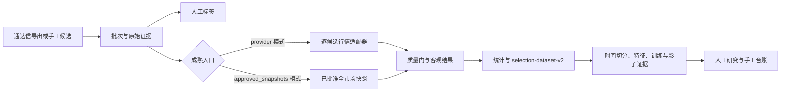

# StratGauge 系统规格说明

> 衡量优势，以证据交易。

本文是当前代码实现的技术基线，描述产品边界、模块职责、数据契约、缓存策略、选股成熟链路、机器学习链路和已实现 HTTP API。具体命令参数与每个输入框的使用方法见 [`docs/使用文档.md`](使用文档.md)。当本文与历史计划冲突时，以当前代码、测试和 `docs/current-state.md` 的事实为准。

## 1. 产品定义与边界

StratGauge 是面向单个用户的半自动 A 股研究和决策支持应用：通达信或用户产生候选，系统保存证据、连接日线行情、计算客观结果、统计历史样本，并以只读方式展示模型证据。

系统不连接券商，不自动下单，不自动修改策略或模型，不提供收益保证。用户始终负责确认、下单、成交确认和复盘。

当前实现重点是一个可复现的半手动闭环：



### 当前包含

- 沪深主板日线数据、Tushare 主源、BaoStock 备用/交叉校验、AKShare 兼容源和歪枣网临时恢复源；
- 内容寻址 raw JSON、标准化 Parquet、DuckDB 清单和质量报告；
- Tushare `stock_basic`、交易日历、时间点股票池和证券主数据快照；
- 通达信 CSV/TSV/分号分隔/TXT/EBK 导入、手工候选、人工标签、固定持有期客观结果和成熟任务账本；
- 全市场逐交易日行情、复权因子和只消费批准快照的快照重放成熟队列；
- 特征契约、历史时间点保护、离线常数基线、可选 LightGBM、走步验证、validation-only PAVA 校准、模型注册/比较/影子评分/漂移报告；
- 公式和批次管理、条件历史统计、只读推荐工作台、证券搜索和手工订单/成交/持仓/复盘 API 及 React 前端。

### 当前不包含

- 券商连接、自动交易、分钟线、Tick、新闻驱动信号；
- 通达信公式解析器或执行器；
- Web 请求内训练模型、自动晋升模型、自动选择 provider；
- 将未校准模型分数渲染成权威胜率；
- 用当前股票池回答没有历史快照的历史查询。

## 2. 模块与目录

```text
StratGauge/
├── backend/
│   ├── src/stratgauge/
│   │   ├── api/                 FastAPI 路由、请求模型和应用服务
│   │   ├── domain/              证券、行情、策略、选股、组合领域模型
│   │   ├── data_sources/        Tushare/BaoStock/AKShare/歪枣网适配器
│   │   ├── data_pipeline/       导入、同步、缓存、快照、质量门和存储
│   │   ├── features/            特征版本、时间点校验和特征快照
│   │   ├── backtest/             入场政策、结果、统计、数据集和任务
│   │   ├── strategies/           安全 AST、策略存储和生命周期
│   │   └── ml/                  训练、校准、注册、比较、影子和漂移
│   ├── scripts/                 显式 CLI；不注册后台定时器
│   └── tests/                   默认离线单元/契约/回归测试
├── frontend/src/                React/Vite/TypeScript 工作台
├── docs/                        规格、使用说明、决策、状态和会话记录
└── data/                        默认本地运行数据，不应提交到 Git
```

后端是模块化单体。领域逻辑不直接依赖第三方 provider；provider 库只在 `data_sources/` 内导入。长流程通过本地任务账本和显式 CLI/Windows Task Scheduler 调度，不引入 Redis/Celery。

## 3. 时间点、身份和不可变性

### 3.1 时间字段

- `event_time`：市场事件发生时间，日线默认按交易日 15:00（Asia/Shanghai）表达；
- `available_at`：系统认为该记录可供研究使用的时间；标准化时至少不早于抓取时间和日线事件时间；
- `ingested_at`：进入本地系统的时间；
- `as_of`：调用方要求的研究可见时间；
- `selection_date`：候选/信号归属日；
- `evaluated_at`：成熟结果允许看到后续行情的截止时间；
- `observed_at`/`known_at`：证券主数据的观察/知晓时间；
- `created_at`：快照、任务或模型证据的创建时间。

所有带时区的时间都由 Pydantic 领域模型验证；无时区输入失败。特征引擎同时要求行情交易日严格早于 `selection_date`，且每条行情 `available_at <= as_of`。

### 3.2 证券身份

领域层只接受 `SH`、`SZ`、`BJ` 三种交易所，并由 `canonical_symbol(local_code, exchange)` 生成 `CODE.EXCHANGE`。六位代码前缀不是交易所契约。名称是显示属性，不是主键；用户名称覆写只影响显示层。

### 3.3 内容身份

原始请求参数、记录、适配器版本和抓取时间进入内容寻址 payload；raw、规范化数据、manifest、质量报告和模型工件均保留 SHA-256。重复内容返回相同 snapshot/model ID；不同内容不覆盖旧证据。manifest 的状态可以从 `pending` 更新为 `approved`/`rejected`，但不会改变 raw 或 normalized 内容。

## 4. 数据源与适配器契约

### 4.1 provider 角色

| provider | 日线 | 全市场日线 | 复权因子 | 主数据/日历 | 凭据/备注 |
| --- | --- | --- | --- | --- | --- |
| Tushare | 主 | 主 | 主 | `stock_basic`/`trade_cal` | `TUSHARE_TOKEN`；官方 HTTPS Data API |
| BaoStock | 备用/交叉校验 | 否 | 否 | 备用交易日历 | `live-data` 可选依赖 |
| AKShare | 兼容 | 否 | 否 | 备用交易日历 | `live-data` 可选依赖；内部延迟导入 |
| 歪枣网 | 临时恢复 | 否 | 否 | 否 | `WAIZAO_TOKEN`；当前逐代码 HTTP 日线 |

所有日线适配器实现 `fetch_daily_bars(DailyBarRequest)`，返回 provider、适配器版本、请求、抓取时间、原始行和标准化 `DailyBar`。全市场同步另实现 `fetch_market_daily(MarketDailyRequest)`；复权因子另实现 `fetch_adjustment_factors(AdjustmentFactorRequest)`。

Tushare `daily` 的 `vol` 是手、`amount` 是千元；适配器边界分别乘以 100 和 1000，领域单位是股和元。歪枣网的 `cjl` 也从手转换为股。原始 provider 字段仍保留在 raw 证据中。

### 4.2 远程/本地行为契约

| 管道 | 本地命中条件 | 远程触发条件 |
| --- | --- | --- |
| 交易日历 | 合法 manifest 覆盖请求区间边界 | 首次请求或区间超出左/右覆盖边界 |
| Tushare 股票池 | 无自动跳过判断 | 每次运行 `sync_tushare_universe.py` 都调用 `stock_basic` |
| 全市场日线 | provider + 日期 + universe + `approved/market_daily` 命中 | 未命中批准快照；拒绝快照也不算命中 |
| 全市场复权因子 | provider + 日期 + universe + source daily snapshot 的批准因子命中 | 无匹配批准因子，且同日市场日线已批准 |
| 单票成熟/历史补数 | provider 模式不预查单票快照 | 每个候选/目标调用 provider 适配器 |
| 快照重放成熟 | 任务固定的所有输入快照均批准、可用、同股票池 | 不会远程回退；任一条件失败即失败 |
| 查询/标签/统计/模型/组合 | 本地 JSON、Parquet、DuckDB | 不访问行情源 |

单票 `ingest()` 的“幂等”是存储幂等，不是网络缓存：先调用适配器，再写内容寻址快照。因此必须区分“provider 请求被跳过”和“远程响应写入时没有重复文件”。

交易日历缓存由文本和 manifest 双文件组成，文件与 manifest 哈希不一致、缺一、交易所不一致或日期重复/乱序都会阻断消费。备用日历每个缺口同时请求 BaoStock 和 AKShare；两集合不完全一致时不发布主缓存。

## 5. 数据管道和质量门

### 5.1 日线快照

全市场日线同步以一个交易日和一个批准时间点股票池为范围，构造 `MarketDailyRequest`。默认最低证券覆盖率为 `0.90`；缺失证券在全市场模式是聚合警告，低于阈值才拒绝。OHLC 关系、负成交量/金额、日期范围、重复键、证券范围、来源格式和跨源差异由质量门处理。

单票历史补数要求每个目标覆盖选股日前的精确交易日窗口；单票成熟只使用选股日之后到 `evaluated_at.date()` 的区间。质量失败不会生成可消费的批准快照。

### 5.2 复权因子

因子不是执行价格。每个因子快照必须绑定：

```text
provider
session_date
universe_snapshot_id
source_daily_snapshot_id
```

批量因子补齐先查同日、同源、同股票池的已批准全市场日线；找不到时记录 `missing_daily_snapshot`，不调用 `adj_factor`。研究阶段可用 `forward_adjust_daily_bars` 生成前复权输入，但不改写原始 `DailyBar`、成交价或客观结果。

### 5.3 失败和重试

适配器把网络、连接、超时、限流和 408/429/5xx 等明确传输失败标成可重试；格式错误、质量门失败、数据冲突、快照血缘不匹配和参数错误不自动重试。成熟任务每次尝试都写事件，任务最终状态可以是 `queued`、`running`、`completed`、`partial` 或 `failed`。

## 6. 半手动选股领域

### 6.1 导入

`TdxSelectionImport` 包含一个不可变 `SelectionBatch` 和多个 `SelectionCandidate`。批次保存源文件 SHA-256、原始文件名、选股日期、导出时间、导入时间、公式名称/版本/ID/哈希和候选数；候选保存标准代码、名称和原始字段。

解析器支持：

- UTF-8/UTF-8 BOM 或 GB18030；
- CSV、TSV、分号分隔文本；
- 仅含七位市场前缀代码的 `.EBK`；
- 通达信行情表 TXT 的 GBK/GB18030 制表符结构和来源尾行。

普通表格必须存在代码列；交易所列名支持 `市场`、`交易所`、`exchange`、`market`，代码列支持 `代码`、`证券代码`、`股票代码`、`code`、`symbol`，名称列支持 `名称`、`名称(n)`（例如 `名称(4)`、`名称(5)`）、`证券名称`、`股票名称`、`name`。没有明确交易所时拒绝，不按代码前缀猜测；只有满足通达信行情表特征时，才按其代码命名空间解析交易所。

### 6.2 人工标签与客观结果

人工标签枚举是 `buy_candidate`、`watch`、`pass`、`invalid`，必须在导出后、选股日次日开始前追加保存。`buy_candidate` 表示下一交易日优先复核，不代表已经成交；`watch` 表示暂不买入、继续观察。若实际成交发生在更晚日期，必须通过手工订单/成交台账记录，不能修改标签来代替成交事实。客观结果由行情和 `SelectionTrackingPolicy` 生成，两者不能互相替代。

默认研究政策为 `outcome-fixed-10-net-positive-v1`：固定 10 个交易日、无止盈止损、扣费后净收益正为胜、零为平、负为负；`no_entry` 和 `unresolved` 单独保留。沪深主板按 100 股整手和最低佣金规则计算，默认名义金额 10000 元。任何参数变更都产生新的政策指纹。

### 6.3 人工评审和实际交易

当前人工评审使用追加式 `SelectionAnnotation`：评分、观点和当前决策必填，位置/形态/量价/板块标签按 `selection-annotation-taxonomy-v1` 固定词表多选；复查允许在后续交易日追加，当前状态由最新评审投影。数据无效使用独立 `SelectionCandidateExclusion` 事件，不等同于放弃决策。

实际买入不修改人工评审，而通过 `/v1/selection-candidate-trades` 原子写入候选关联订单和成交。候选关联的卖出订单用于卖出择时数据；未关联卖出会阻断归因，不猜测候选归属。

### 6.4 多周期表现和机器学习数据集

成熟任务同时保存独立 `SelectionPerformance`，默认计算 T+1/T+3/T+5/T+10 收盘收益、窗口最大涨幅、收盘路径最大回撤和可选目标收益达成。最大回撤使用收盘路径，因为日线 OHLC 无法证明盘中高低点顺序。

模型数据按用途分为：候选成功率、逐次人工评审、买入择时和卖出择时。买入/卖出择时必须传入显式交易日历和评估截止时间；观察窗口未结束时标签保持 `null`。新数据集通过 `export_selection_ml_datasets.py` 导出，再由 `prepare_selection_training_dataset.py` 转换为独立训练标签契约；跨边界才可见的标签进入 `purged` 分区。`train_selection_label_baseline.py` 仅消费准备后的标签分区，人工决策使用三分类，其他用途使用独立二分类；不自动触发特征 join、LightGBM、模型注册或模型晋升。

### 6.5 成熟模式

- **provider 模式**：直接成熟 CLI、Web 一次性成熟和普通成熟任务逐候选调用适配器；同一成熟任务已有的 candidate outcome 可复用，其余候选仍按 provider 规则请求。
- **approved_snapshots 模式**：由全市场批准快照队列创建，固定保存所有输入快照 ID、股票池 ID、政策和评估时间；执行只读取本地 Parquet，不调用 provider，也不回退。

统计按候选和追踪政策取最新结果，分离完成、未入场和未解决；完成样本少于 100 时保留计数但不返回胜率。

## 7. 特征、回测和机器学习

### 7.1 特征

默认特征集由 `features/contract.py` 定义，覆盖收盘价、1/5/20 日收益、5/20 日波动率、5/20 日均线距离、20 日量比、20 日成交额均值、基准收益和相对强弱。特征快照保存特征集 ID、输入 session 范围、source snapshot IDs、`available_at` 和值。

特征引擎拒绝：选股日及之后行情、`available_at > as_of`、重复证券/日期、缺少必需回看窗口、缺少基准、基准日期未对齐、缺少因子血缘和无 source snapshot ID。复权因子只在显式传入时使用。

### 7.2 回测与报告

回测区分信号、订单意图、成交模拟和实际成交。收盘后信号不能在当天成交；停牌、无价格交集、跳空超追价、T+1、最低佣金和止盈/止损同日歧义使用保守规则。`report_backtest.py` 生成理论报告；市场状态必须由调用方显式提供日期到状态的 JSON 映射，缺失状态为 `unspecified`，不会从收益曲线事后推断。

### 7.3 训练与模型运营

训练输入是带 schema 的特征 JSONL，按选股日期分成 train/validation/test，不随机打乱。准入审计默认至少 100 个完成结果且策略参数已冻结。常数基线只用于流程对照；LightGBM 是可选依赖、固定配置的未校准候选。走步验证接受显式 folds 和可选客观结果 JSONL；test 不参加折评估。

概率校准只使用 validation 预测拟合 PAVA Isotonic，test 只应用校准器。模型注册时同时保存元数据、可执行工件、评估和训练 manifest 的副本与哈希。模型生命周期由人工追加，激活必须引用匹配的评估哈希和通过的比较报告。影子评分保存原始/校准分数，但 `authoritative=false` 且 `used_for_decision=false`。

## 8. 本地存储模型

`SnapshotStore`：

```text
<market-root>/
├── raw/snapshot-*.json
├── normalized/snapshot-*.parquet
├── manifests/snapshot-*.json
├── quality/quality-*.json
└── catalog.duckdb
```

请求类别由 manifest 的 `request_kind` 区分：`security_daily`、`market_daily`、`adjustment_factor`。`load_bars()` 和 `load_adjustment_factors()` 只接受批准快照。

`SelectionImportStore` 保存 raw 二进制、解析导入、manifest、公式、标签、结果、成熟任务和事件；`FeatureSnapshotStore`、策略存储、模型注册表和组合存储均采用本地不可变/追加式文件。DuckDB 是索引和查询元数据，不替代 raw/Parquet 证据。

## 9. HTTP API 实现索引

当前实际路由如下，参数和 JSON 字段的逐项说明在使用文档第 8 节：

```text
GET  /healthz
GET  /v1/stocks/{symbol}/analysis
POST /v1/universe/overrides
GET  /v1/universe/master
GET  /v1/universe/securities

GET  /v1/positions
GET  /v1/manual-orders
GET  /v1/manual-fills
GET  /v1/portfolio-reviews
POST /v1/manual-orders
POST /v1/manual-fills
POST /v1/selection-candidate-trades
POST /v1/portfolio-reviews

GET  /v1/formulas
POST /v1/formulas
GET  /v1/data-management/formulas
POST /v1/data-management/formulas/{formula_id}/archive
POST /v1/data-management/formulas/{formula_id}/restore

GET  /v1/selection-batches
POST /v1/selection-batches
POST /v1/selection-batches/manual
GET  /v1/selection-batches/{batch_id}
GET  /v1/selection-batches/{batch_id}/stats
GET  /v1/selection-batches/{batch_id}/maturity-tasks
POST /v1/selection-batches/{batch_id}/maturity-tasks
POST /v1/selection-batches/{batch_id}/mature
POST /v1/selection-batches/{batch_id}/labels
POST /v1/selection-batches/{batch_id}/annotations
POST /v1/selection-batches/{batch_id}/exclusions
GET  /v1/selection-observation-pool
GET  /v1/selection-batches/{batch_id}/candidates/{candidate_id}/analysis
GET  /v1/selection-batches/{batch_id}/candidates/{candidate_id}/model-scores
GET  /v1/selection-batches/{batch_id}/recommendation-workbench
POST /v1/maturity-tasks/{task_id}/run

GET  /v1/data-management/batches
GET  /v1/data-management/batches/{batch_id}
GET  /v1/data-management/batches/{batch_id}/raw
GET  /v1/data-management/batches/{batch_id}/dataset
GET  /v1/data-management/batches/{batch_id}/annotation-dataset
POST /v1/data-management/batches/{batch_id}/archive
POST /v1/data-management/batches/{batch_id}/restore
GET  /v1/data-management/stats
```

错误统一返回 `error.code`、`error.message` 和预留的 `error.details`。分析、股票池、成熟、模型和组合服务都显式区分未找到、未批准、输入非法、存储错误和任务失败；不会用零概率、当前价格或当前股票池静默降级。

## 10. 安全与运行约束

- provider token 只能来自环境变量；请求证据不得包含 token；
- 策略表达式只能通过安全 AST，禁止 `eval`/`exec`；
- 默认离线测试不访问网络；真实抓取只能由显式脚本触发；
- 质量失败、过期数据、未来快照、股票池不匹配和缺少血缘都会阻止发布或重放；
- 所有用户交易记录都是人工台账，与理论策略结果、推荐结果和模型分数分开；
- 修改文档或代码后至少执行相关测试、Ruff、MyPy 或前端类型/构建检查，并在会话记录中写实际结果。

## 11. 当前已知事项

- Tushare `trade_cal` 原生端点仍保留供应商溯源补验；运行时可用的正式交易日历是已由 BaoStock + AKShare 完整一致校验的备用缓存，不把备用来源冒充 Tushare。
- 连续的历史证券主数据档案需要在配额允许时按多个观察时间运行 `sync_tushare_universe.py --historical`；当前查询严格拒绝没有对应时间点快照的请求。
- 候选批次尚未自动组装特征快照并自动进入模型评分；模型和影子证据仍需显式离线 CLI/本地存储流程。
- 本文和使用文档描述当前实现，不代表未来用户最终交易参数；新政策必须创建新的不可变 ID。
